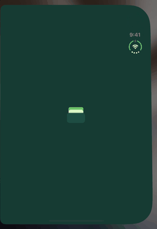
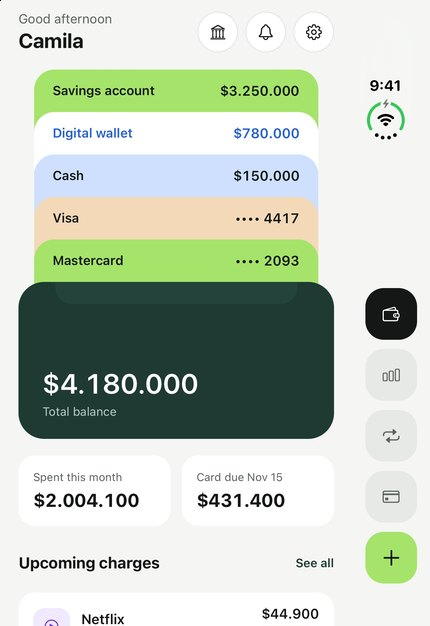
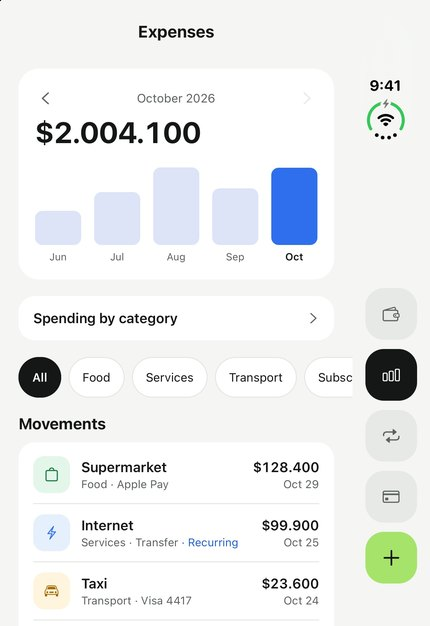
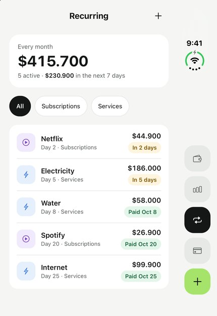
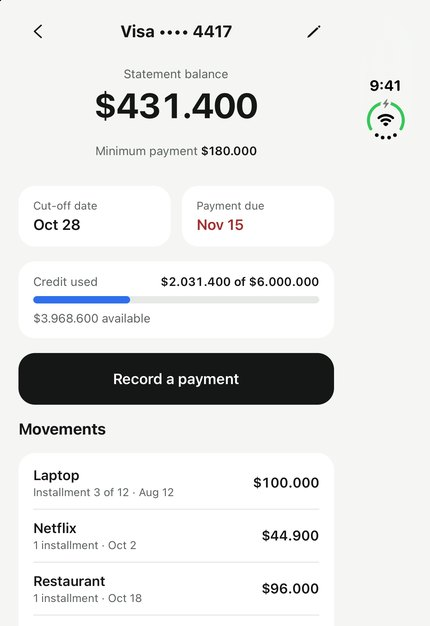
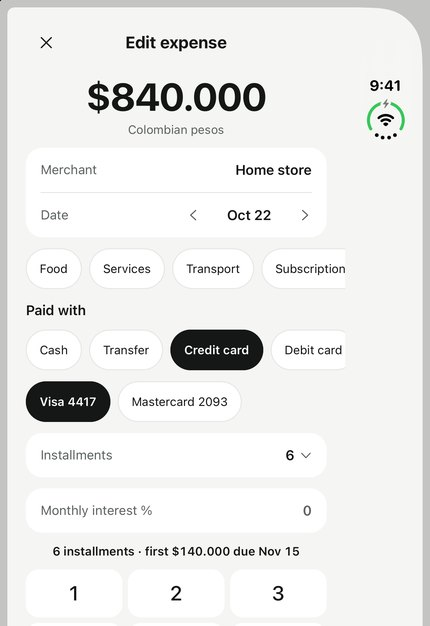
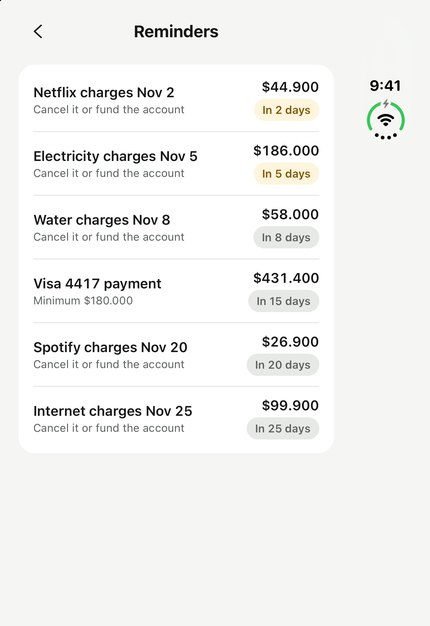
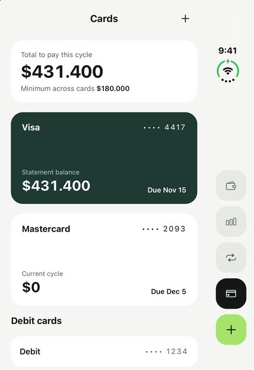
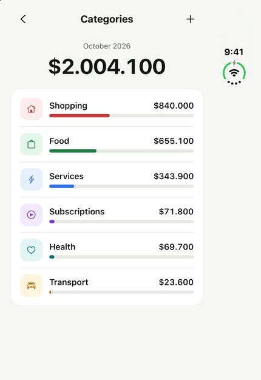

<div align="center">


# Finance

**A private money tracker for iPhone. Your data never leaves your phone.**

No accounts. No servers. No bank logins.



</div>

## See it

<table>
  <tr>
    <td align="center"><br /><b>Your wallet</b></td>
    <td align="center"><br /><b>Every expense</b></td>
    <td align="center"><br /><b>Recurring charges</b></td>
  </tr>
  <tr>
    <td align="center"><br /><b>Card statements</b></td>
    <td align="center"><br /><b>Installments</b></td>
    <td align="center"><br /><b>Reminders</b></td>
  </tr>
  <tr>
    <td align="center"><br /><b>All your cards</b></td>
    <td align="center"><br /><b>Spending by category</b></td>
    <td></td>
  </tr>
</table>

<sub>Screens use sample data on the iPhone Duo simulator, so the buttons sit in its side column. Other iPhones show them along the bottom.</sub>

## What it does

- **Apple Pay registers itself.** A Shortcut saves each payment, matches the card and remembers the merchant's category.
- **Credit cards that make sense.** Cut-off and due dates, statements, minimum payments, credit used and partial payments.
- **Installments.** Choose 1 to 36, with optional monthly interest and a live payment plan.
- **No more surprise charges.** Subscriptions and services register themselves, with a reminder before each one.
- **Real balances.** Expenses and card payments update your accounts automatically.
- **See where it goes.** Monthly charts, categories you can customize, and filters.
- **Your data stays yours.** Everything lives on the device, with CSV export and full backup and restore.
- **It feels native.** Animated wallet, haptics, skeleton loading, Reduce Motion support and foldable layouts.

## Install it

You need a Mac, Xcode, Node.js and an iPhone. A free Apple ID is enough, so there's no App Store download or $99 account.

1. Clone the project and install it:

   ```bash
   git clone https://github.com/Anvidneo/financial-app.git
   ```

   ```bash
   cd financial-app
   ```

   ```bash
   npm install
   ```

2. In `app.json`, change `ios.bundleIdentifier` to your own and set `ios.appleTeamId` to your team ID. Use the same bundle identifier for `BUNDLE_ID` in `scripts/install-iphone.sh`.
3. In Xcode, open Settings > Apple Accounts and add your Apple ID.
4. On the iPhone, turn on Settings > Privacy & Security > Developer Mode, then connect it to the Mac.
5. Build and install:

   ```bash
   npm run ios:device
   ```

6. On the iPhone, open Settings > General > VPN & Device Management and trust your developer profile.

> [!IMPORTANT]
> Installs from a free Apple ID stop opening after 7 days. Run `npm run ios:device` again, right over the app. **Never delete the app first, because that erases your data.** Finance warns you before it expires.

Prefer the Simulator? Run `npm run ios`.

### Set up Apple Pay

Open Finance, go to Settings, and follow the Apple Pay Shortcut steps. Once it's connected, each payment saves itself.

## Built with

React Native · Expo · TypeScript · Expo Router · SQLite · Reanimated · Expo Notifications · iOS Shortcuts

Currency is Colombian pesos (COP), and the app is iPhone only for now.

## Development

```bash
npm test
```

```bash
npm run typecheck
```

Publishing to the stores is covered in the [publishing guide](docs/PUBLISHING.md).
